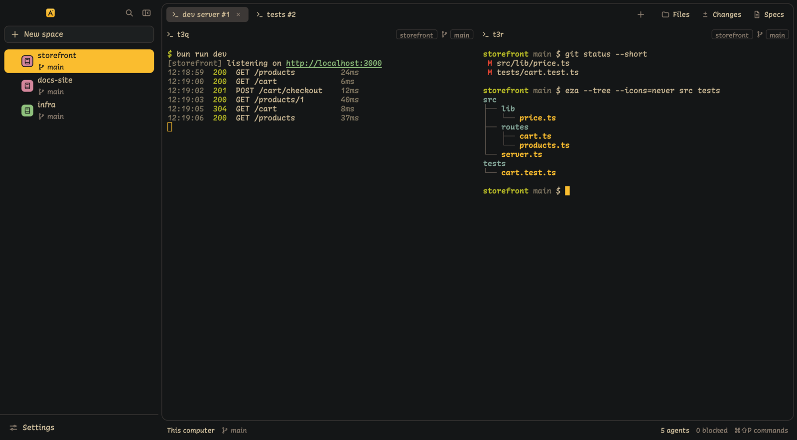
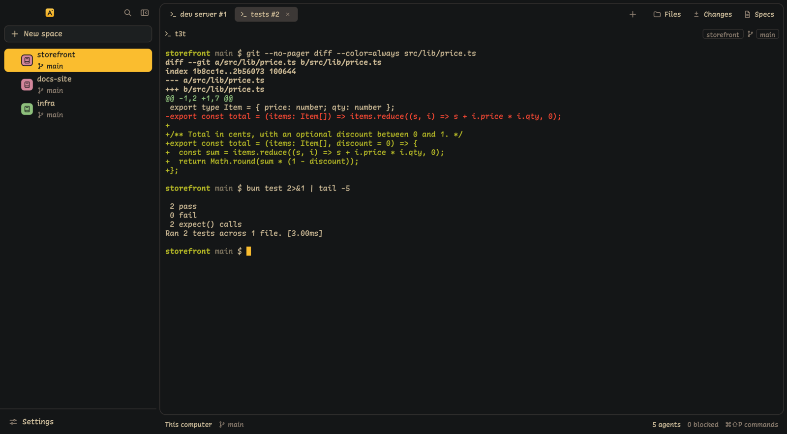
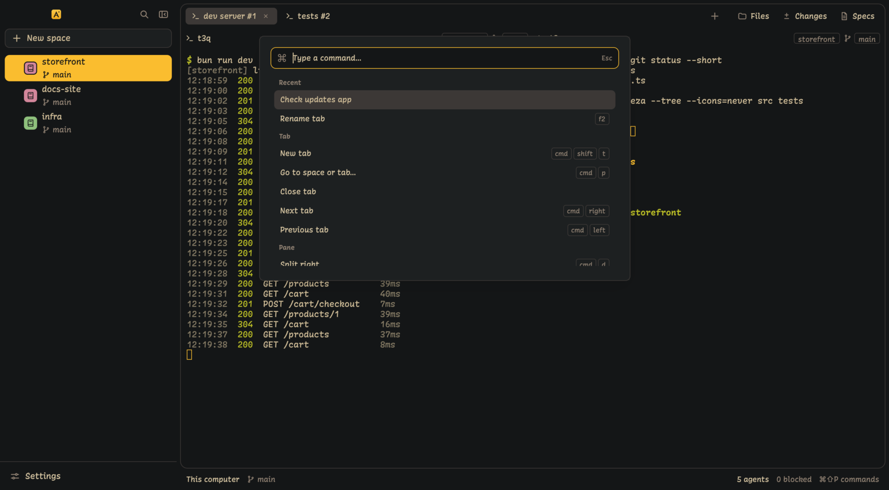
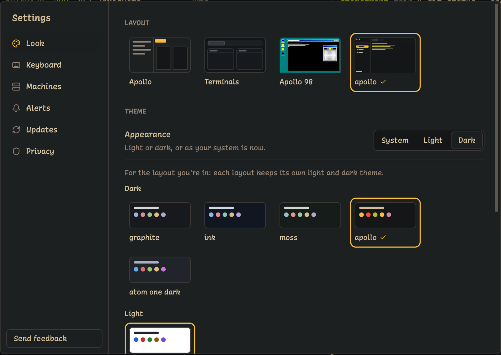
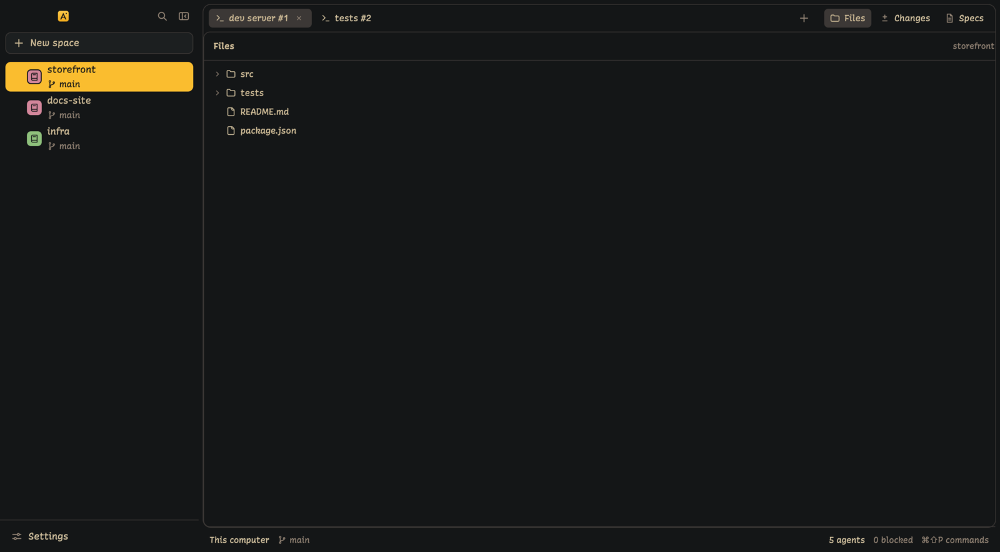
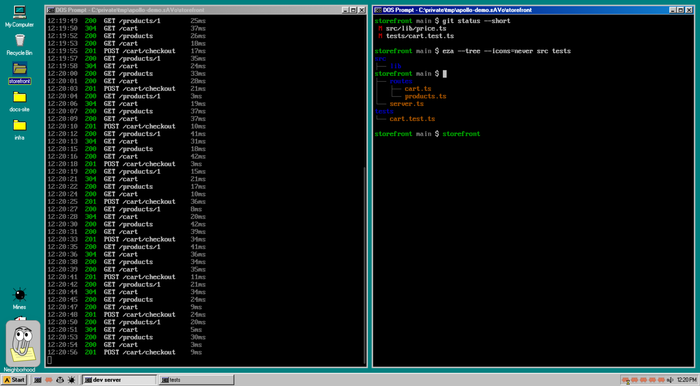

# Apollo

**A desktop home for your terminals and coding agents.**

  

**[Download](https://github.com/ForYouzi/apollo-app/releases/latest)** · **[Documentation](wiki/Home.md)**

macOS (Apple silicon and Intel) · Windows x64

  
   
  <b>One space per project.</b> Tabs and split panes inside; the sidebar keeps every space one click away.

## Why Apollo

- **Spaces, tabs and panes.** Keep each project in its own space, and split terminals side by side.
- **See which agent needs you.** Agents show as working, blocked or done, across every space.
- **Terminals outlive the window.** [herdr-core](https://github.com/herdrdev/herdr-core) runs them; close the window and come back later, even over SSH.
- **Clickable everything.** URLs and file paths in terminal output open or reveal with one click, even when a program wraps them.
- **Make it yours.** Layouts, themes and JavaScript mods change the whole window, not just its colors.

## A closer look

<table>
  <tr>
    <td width="50%"> <b>Tabs</b> — a dev server in one, your diff and tests in the next.</td>
    <td width="50%"> <b>Changes</b> — what Git sees, one click from your terminals.</td>
  </tr>
  <tr>
    <td width="50%"> <b>Command palette</b> — every action, with its key.</td>
    <td width="50%"> <b>Layouts and themes</b> — pick a layout; each keeps its own light and dark theme.</td>
  </tr>
  <tr>
    <td width="50%"> <b>Files</b> — the space's folder beside your work.</td>
    <td width="50%"> <b>Apollo 98</b> — the same terminals, redrawn entirely by mods.</td>
  </tr>
</table>

## Get started

Download the [latest release](https://github.com/ForYouzi/apollo-app/releases/latest) for your platform and open it. Apollo shares Herdr's settings in `~/.config/herdr-app`, so an existing Herdr setup just works. See [Install](wiki/Install.md) for first-launch steps.

## Documentation

[Install](wiki/Install.md) · [Usage](wiki/Usage.md) · [Customize](wiki/Customize.md) · [Layouts and Mods](wiki/Layouts-and-Mods.md) · [Commands](wiki/Commands.md) · [For Agents](wiki/For-Agents.md) · [Security and Privacy](wiki/Security-and-Privacy.md) · [Building](wiki/Building.md)

## Thanks, Herdr

Apollo is a fork of [herdr-app](https://github.com/herdrdev/herdr-app), the Herdr desktop app, and runs its terminals in [herdr-core](https://github.com/herdrdev/herdr-core). It takes Herdr's changes before every release.

## License

[Apache-2.0](LICENSE)
